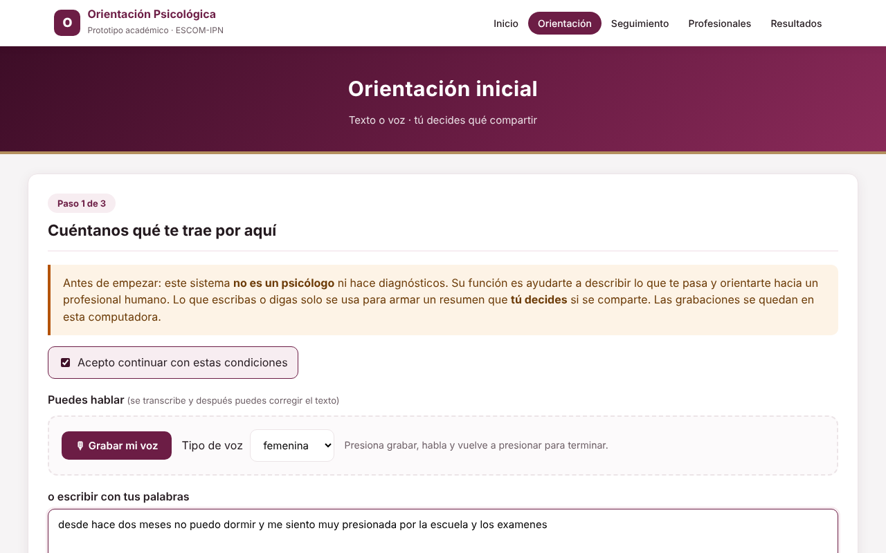
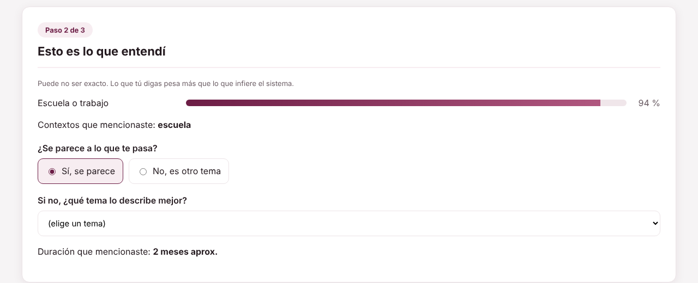
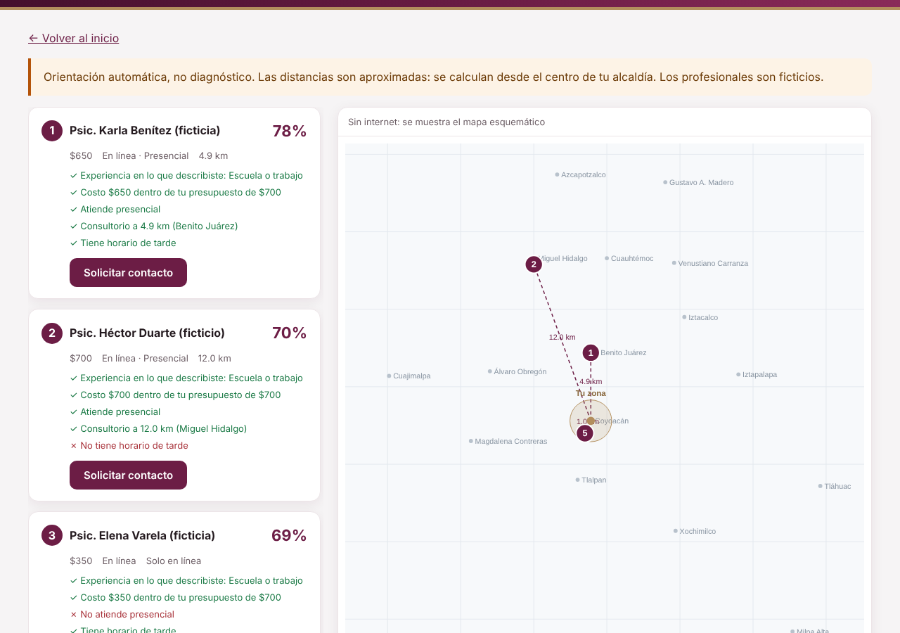
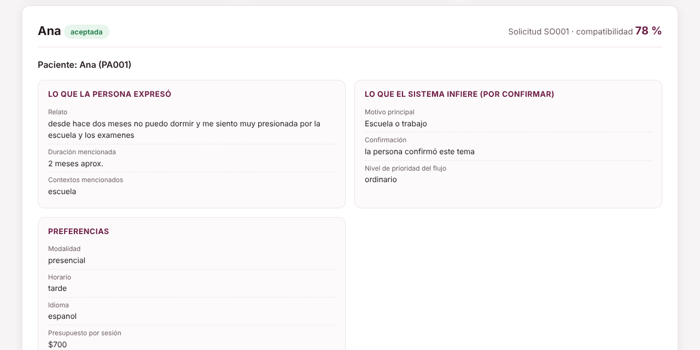
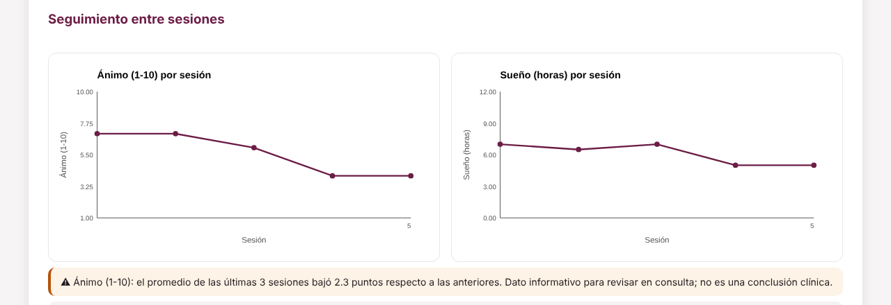
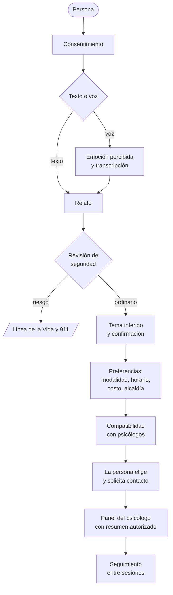

<div align="center">

# Sistema Inteligente Multimodal de Acceso, Orientación y Vinculación Psicológica

**Orienta a una persona a partir de lo que dice o escribe, y la vincula con un psicólogo compatible.**
**Todos los algoritmos principales están programados desde cero en Python.**


*Temas Selectos de Aprendizaje Profundo · Escuela Superior de Cómputo · Instituto Politécnico Nacional*

</div>

> [!IMPORTANT]
> Es un prototipo académico de **orientación**: no diagnostica, no sustituye a un profesional y no
> atiende emergencias. Si detecta una situación de riesgo, detiene el flujo y muestra la Línea de la
> Vida (800 911 2000) y el 911.

---

## Vista previa

<table>
<tr>
<td width="50%"><p align="center"><b>Inicio</b></p></td>
<td width="50%"><p align="center"><b>Relato por texto o voz</b></p></td>
</tr>
<tr>
<td><p align="center"><b>La persona confirma o corrige el tema</b></p></td>
<td><p align="center"><b>Opciones compatibles con distancia y mapa</b></p></td>
</tr>
<tr>
<td><p align="center"><b>Resumen autorizado en el panel del psicólogo</b></p></td>
<td><p align="center"><b>Seguimiento de ánimo y sueño</b></p></td>
</tr>
</table>

<sub>Con internet, el mapa usa OpenStreetMap; sin internet, el sistema dibuja su propio mapa esquemático (el de la captura).</sub>

---

## ¿Cómo funciona?



---

## Resultados

| Componente | Método propio | Resultado |
|---|---|---|
| Emociones en la voz (4 clases, MESD) | 11 variables acústicas + red neuronal | **65.7 %** de exactitud (azar: 25 %) |
| Palabras aisladas (24 palabras, MESD) | MFCC + FFT + red neuronal | **38.2 %** con una voz no vista (azar: 4.2 %) · 50.4 % con voces conocidas |
| Motivo de consulta (8 temas) | TF-IDF + Naive Bayes / red neuronal | 80.2 % en el conjunto de prueba (corpus sintético) |
| Seguridad | Reglas con negación | 20 de 20 casos de riesgo detectados · 2 falsas alarmas |
| Extracción de duración | Reglas de expresiones temporales | F1 = **0.93** en la detección · 90 % de valor exacto |
| Extracción de contextos | Diccionarios con lematización ligera | micro F1 = **0.99** |
| Compatibilidad paciente-psicólogo | Similitud coseno + criterios ponderados | precision@3 contra el orden del equipo *(en anotación)* |

Las métricas (exactitud, precision, recall, F1, matriz de confusión, precision@3) también están
implementadas a mano. Los modelos se evalúan con validación cruzada agrupada para no evaluar con
datos que el modelo ya vio.

---

## Algoritmos implementados desde cero

<details>
<summary><b>Ver la lista completa</b></summary>

| Área | Qué se programó |
|---|---|
| Matemáticas | Raíz cuadrada (Newton), seno y coseno (Taylor), exponencial, logaritmo, generador aleatorio (LCG, Box-Muller, Fisher-Yates) |
| Audio | Lectura y escritura de WAV byte por byte (8, 16, 24 y 32 bits), filtro pasa-bajas FIR, remuestreo, ventanas de Hann |
| Señales | DFT, FFT radix-2 (Cooley-Tukey), detección de voz por energía RMS, frecuencia fundamental por autocorrelación |
| Características | RMS, ZCR, centroide y ancho de banda espectral, F0, tasa silábica, MFCC (filtros mel + DCT) |
| Redes neuronales | Perceptrón multicapa con ReLU y softmax, entropía cruzada, regularización L2, retropropagación, descenso por mini-lotes con momento, verificación de gradientes |
| Texto | Normalización, tokenización, negación, palabras vacías, lematización ligera, bigramas, TF-IDF, Naive Bayes multinomial |
| Vinculación | Similitud coseno, puntaje ponderado explicable, distancia equirrectangular, cercanía, mínimos cuadrados para tendencias |
| Evaluación | Matriz de confusión, precision, recall, F1, validación cruzada agrupada y estratificada, precision@3, conteo de Borda |

</details>

---

## Instalación y uso

**Requisito:** Python 3.10 o superior. El núcleo no necesita instalar nada.

```bash
git clone https://github.com/cast06/analisis-digital-voz.git
cd analisis-digital-voz
python pruebas.py          # 122 pruebas con valores conocidos
python entrenar_texto.py   # entrena el clasificador de motivos
python servidor.py         # abre el sistema en http://localhost:8000
```

<details>
<summary><b>Entrenar los modelos de voz con MESD</b></summary>

1. Descarga la [Mexican Emotional Speech Database](https://data.mendeley.com/datasets/cy34mh68j9/5).
2. Como el programa no usa módulos para recorrer carpetas, genera la lista de archivos en PowerShell:
   ```powershell
   Get-ChildItem -Path "RUTA\A\MESD" -Recurse -Filter *.wav | ForEach-Object { $_.FullName } | Set-Content -Encoding UTF8 datos\lista_mesd.txt
   ```
3. Entrena y evalúa:
   ```bash
   python entrenar_emociones.py
   python entrenar_palabras.py
   ```

</details>

<details>
<summary><b>Activar la voz en vivo (opcional)</b></summary>

```bash
pip install -r requisitos_voz.txt
```

Descarga el modelo en español `vosk-model-small-es-0.42` desde
[alphacephei.com/vosk/models](https://alphacephei.com/vosk/models) y descomprímelo en `datos/`.
Sin esto, el sistema funciona igual por texto.

</details>

<details>
<summary><b>Otros comandos</b></summary>

| Comando | Qué hace |
|---|---|
| `python main.py` | El mismo sistema en un menú de consola |
| `python evaluar_vinculacion.py` | Evalúa la extracción y el matching |
| `python analisis_senales.py` | Experimentos de señales (Fourier, ventanas, detección de voz) |
| `python clasificar_voz.py` | Palabra y emoción de un archivo `.wav` |

</details>

---

## Uso de librerías

| Capa | Qué usa | Por qué |
|---|---|---|
| **Núcleo** (voz, texto, redes, vinculación, métricas) | Nada: solo funciones nativas de Python | Restricción de la materia |
| Página web | Biblioteca estándar: `http.server`, `urllib.parse`, `json` | Servir las páginas; no decide nada |
| Mapa en el navegador | Leaflet + OpenStreetMap | Solo dibuja; las distancias las calcula nuestro código |
| Voz en vivo *(opcional)* | `sounddevice`, `vosk` | Python puro no puede usar el micrófono ni transcribir habla libre |

---

## Estructura

```
├── servidor.py            Página web (todo el sistema en el navegador)
├── main.py                El mismo sistema en consola
├── nucleo/                Matemáticas, archivos y aleatoriedad propias
├── audio/                 WAV, FFT, MFCC, filtros y características
├── emociones/             Datos de MESD y modelo de emociones
├── palabras/              Reconocimiento de palabras aisladas
├── modelos/               Red neuronal, Naive Bayes y métricas
├── texto/                 NLP, seguridad, extracción y clasificador
├── vinculacion/           Registro, compatibilidad, solicitudes, seguimiento y mapa
├── web/                   Diseño y páginas del servidor
├── voz_en_vivo/           Único módulo con librerías (opcional)
├── corpus/                Frases de entrenamiento y casos de evaluación
├── datos/                 Modelos entrenados y perfiles ficticios
└── pruebas.py             122 pruebas automáticas
```

La documentación técnica completa, con fórmulas y decisiones de diseño, está en [LEEME.md](LEEME.md).

---

## Limitaciones

- Los modelos de voz se entrenaron con voces actuadas de MESD; con voces reales es probable que acierten menos.
- El corpus de motivos de consulta y los 18 psicólogos son **sintéticos** y falta que los revise un especialista.
- La voz reconoce solo 24 palabras de un vocabulario cerrado; la transcripción libre depende de vosk.
- Las ubicaciones son aproximadas por alcaldía de la Ciudad de México.

## Trabajo futuro

- Grabar un vocabulario propio relacionado con la orientación psicológica.
- Completar la evaluación del matching con el orden de varios anotadores.
- Validar los criterios de seguridad y el corpus con especialistas, siempre con consentimiento informado.

---

## Datos

- **MESD:** Duville, M. M., Alonso-Valerdi, L. M. e Ibarra-Zarate, D. I. (2021). *Mexican Emotional Speech
  Database Based on Semantic, Frequency, Familiarity, Concreteness, and Cultural Shaping of Affective Prosody.*
  Data, 6(12), 130. https://doi.org/10.3390/data6120130 · Conjunto de datos: https://doi.org/10.17632/cy34mh68j9.5
- Los perfiles de psicólogos, los casos de evaluación y el corpus de motivos son ficticios, creados para el prototipo.

---

<div align="center">

### Equipo

**Luis Antonio Palma Hernández** · **Sharon Xolocotzin Castillo** · **Edna Jania Santiago Trejo**

Profesor: **Horacio Alberto García Salas**

Temas Selectos de Aprendizaje Profundo · ESCOM-IPN · 2026

</div>
